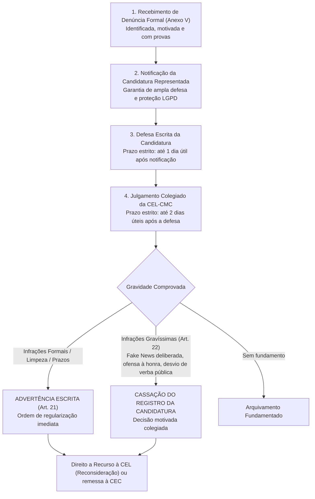
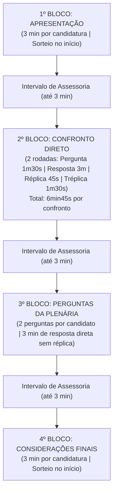
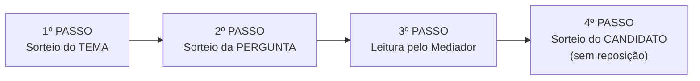

# CARTILHA DE ORIENTAÇÃO NORMATIVA E OPERACIONAL:
# PROPAGANDA ELEITORAL E REGULAMENTO DO DEBATE
## CONSULTA À COMUNIDADE PARA DIRETOR(A)-GERAL DO CAMPUS MANAUS CENTRO (CMC) • QUADRIÊNIO 2027/2031

> **Base Normativa Oficial (Conselho Superior):**
> * Resolução nº 092/CONSUP/IFAM, de 06/11/2026 (Regulamento Eleitoral Geral);
> * **Anexo VIII** da Resolução nº 092/2026 (Regras Oficiais do Debate para Reitor e Diretor-Geral);
> * **Anexo IX** da Resolução nº 092/2026 (Regras Oficiais de Propaganda Eleitoral);
> * **Anexo I** (Cronograma Oficial) e **Anexo V** (Procedimento Formal de Denúncias);
> * Contato Institucional da Comissão: `cel.cmc@ifam.edu.br`.

---

# PARTE I — ESTRUTURA INSTITUCIONAL E CRONOGRAMA

## 1. PAPEL DA CEL/CMC E DISTRIBUIÇÃO DAS ATRIBUIÇÕES ENTRE OS 8 MEMBROS

A condução da consulta eleitoral para Diretor(a)-Geral do Campus Manaus Centro exige coordenação prévia, divisão técnica de responsabilidades e respeito irrestrito à isonomia. Abaixo, detalha-se a distribuição oficial de tarefas entre os oito (8) membros da CEL/CMC:

| Membro da CEL / CMC | Função / Segmento | Atribuição Operacional no Evento e na Fiscalização |
| :--- | :--- | :--- |
| **Josiane Faraco** | Presidente | Coordenação geral da CEL, presidência dos trabalhos, deliberação colegiada sobre reparações, pedidos de direito de resposta e decisões de organização. |
| **Gabriela Mello** | Vice-presidente | Supervisão do roteiro com a mediação, controle do cumprimento estrito dos blocos e interlocução direta com as assessorias de bancada. |
| **Cybelle Taveira** | Secretária | Lavratura da ata oficial, registro público da sequência dos sorteios, anotação das ocorrências disciplinares e controle dos tempos de punição. |
| **Cristiane Pereira de Aguiar** | Membro CEL | Conferência prévia dos critérios de admissibilidade e habilitação das perguntas da comunidade acadêmica (Art. 18 do Anexo VIII). |
| **Maurício Roberto da Silva** | Membro CEL | Infraestrutura técnica do auditório, microfones, comando da mesa de som para corte imediato de áudio ao zerar o cronômetro e layout do espaço físico. |
| **Edimilson Cavalcante da Fonseca** | Membro CEL | Comunicação oficial, gestão do canal digital de captação de perguntas, projeção visual em tela e suporte de tecnologia/transmissão. |
| **Jhonata Gabriel Tavares Morais** | Membro CEL | Recepção física e digital de perguntas, atendimento prioritário ao segmento discente e credenciamento dos fiscais. |
| **Carly Caroline Vieira de Souza** | Membro CEL | Organização dos envelopes lacrados por temas, operacionalização física das urnas de sorteio e guarda de evidências. |

> *Nota: Esta divisão de atividades operacionais visa otimizar o fluxo de trabalho no dia do evento e não substitui a competência colegiada da CEL para o julgamento formal de recursos, faltas e denúncias (Resolução nº 092/CONSUP).*

---

## 2. CRONOGRAMA ELEITORAL OPERACIONAL (ANEXO I)

| Data / Período | Horário limite (Manaus) | Etapa e Exigência Regulatória | Base Legal |
| :--- | :---: | :--- | :--- |
| **12/11/2026** | A partir das 19h | Divulgação da lista preliminar e **INÍCIO OFICIAL** da Campanha Eleitoral permitida | Art. 15, § 7º; Anexo I |
| **12 a 25/11/2026** | Contínuo | Campanha Eleitoral autorizada nos ambientes físicos do CMC e na internet | Anexo IX; Anexo I |
| **Até 48h antes do debate** | Prazo estrito | **DIVULGAÇÃO OBRIGATÓRIA** da data, horário, local/link, regras e canal de perguntas do debate | Reg. Art. 6º, § 3º |
| **23 a 25/11/2026** | Conforme agendamento CEL | Janela oficial para realização dos Debates de Diretor(a)-Geral no Campus Manaus Centro | Art. 18; Anexo I |
| **25/11/2026** | **23h59** | **TÉRMINO IMPRORROGÁVEL** da propaganda eleitoral. Proibida qualquer propaganda posterior. | Art. 15; Anexo I |
| **26 e 27/11/2026** | Período contínuo | **VOTAÇÃO ELETRÔNICA OFICIAL** da comunidade através do Sistema Helios Voting | Art. 14; Anexo I |

---

# PARTE II — PROPAGANDA ELEITORAL E FISCALIZAÇÃO DA CAMPANHA

## 3. QUADRO SÍNTESE: O QUE PODE E O QUE NÃO PODE NA CAMPANHA

| Item / Meio | O QUE PODE FAZER? (Permitido) ✅ | O QUE NÃO PODE FAZER? (Vedado) ❌ | Base Legal |
| :--- | :--- | :--- | :--- |
| **Identificação Geral** | Toda propaganda **deve mencionar obrigatoriamente o nome legível do(a) candidato(a)**. | Propaganda anônima, apócrifa ou com omissão da autoria. | Anexo IX, Art. 4º |
| **Brindes e Vestuário** | Distribuição exclusiva de **bótons simples de identificação** da chapa (sem utilidade autônoma). | **Camisetas, bonés, canetas, chaveiros, brindes, cestas básicas, rifas ou sorteios** de qualquer vantagem. | Anexo IX, Art. 5º |
| **Material Gráfico / Impresso** | Folhetos, volantes, santinhos, adesivos e outros impressos gráficos de campanha. | Material que contenha calúnia, injúria, difamação ou preconceito/discriminação (raça, sexo, gênero, idade). | Anexo IX, Art. 6º e 7º |
| **Espaço Físico (CMC)** | Faixas, banners, cartazes, bandeirolas e flâmulas nos ambientes internos autorizados pela CEL. | Pintura em muros, pichação, fixação em patrimônio tombado ou ato que afete a conservação/limpeza do prédio. | Reg. Art. 15, § 3º; Art. 21, II |
| **Aparelhos Sonoros** | **Uso exclusivo** nos debates oficiais e reuniões mediadas pela Comissão. | **Carros de som, minitrios, paredões, caixas de som ou megafones** para propaganda própria, interna ou externa. | Reg. Art. 19, I; Anexo IX, Art. 7º |
| **Símbolos Oficiais** | Citar trajetória acadêmica e funcional no IFAM com respeito institucional. | **Utilizar brasões, marcas, logotipos oficiais do IFAM** ou de entes públicos em impressos e artes de campanha. | Reg. Art. 19, II |
| **Internet e Mídias** | Sites próprios, redes sociais e manifestação livre de eleitores identificáveis. | Perfis fakes, robôs, páginas anônimas, impulsionamento pago irregular ou ataques à honra de concorrentes. | Anexo IX, Arts. 8º e 9º |
| **WhatsApp e Telegram** | Grupos privados legítimos com contatos autorizados; respeitar pedidos de opt-out. | Extração de contatos de sistemas sigilosos do IFAM; disparos em massa automatizados abusivos (spam). | Reg. Art. 15, § 2º |
| **Canais do IFAM** | Divulgação mediada pela CEL: 1 proposta A4 em PDF + 1 e-mail coletivo/dia via comissão. | Acesso direto para postar em perfis/sites oficiais do IFAM ou envio discricionário por e-mails institucionais. | Reg. Art. 15, § 4º; Anexo IX, Art. 9º |
| **Reuniões no Campus** | Reuniões prévias com a comunidade para expor propostas, sem parar aulas/atividades essenciais. | Eventos que paralisem aulas ou setores sem aviso, ou que ofereçam benesses e alimentação para aliciar eleitores. | Reg. Art. 15, § 13; Art. 19, X |
| **Custos e Finanças** | Recursos próprios lícitos ou doações regulares entre pessoas físicas. | **Uso de dinheiro/recursos públicos ou de sindicatos e associações representativas de classe**. | Reg. Art. 19, VII; Art. 22, III |
| **Fiscais no Pleito** | Crachá ou identificação discreta padronizada pela CEL. | Realizar propaganda eleitoral, pedir votos ou usar camisas temáticas na mesa de votação. | Reg. Art. 30, § 4º |

---

## 4. FLUXO DE APURAÇÃO DE DENÚNCIAS E PENALIDADES PELA CEL (ARTS. 20 A 22)

A apuração de infrações de campanha no âmbito do campus CMC segue o devido processo legal administrativo. A CEL CMC é o órgão competente originário para instruir e julgar as denúncias de Diretor(a)-Geral (Art. 20):



* **Etapa 1 — Recebimento:** Denúncia formal com formulário do Anexo V protocolada junto à CEL-CMC, com provas materiais de autoria e fato;
* **Etapa 2 — Notificação:** Citação imediata da candidatura representada, com acesso integral aos autos;
* **Etapa 3 — Defesa Escrita:** Prazo de **1 (um) dia útil** após a notificação formal para apresentação de defesa e documentos (Art. 20, § 1º);
* **Etapa 4 — Julgamento Colegiado:** Prazo de até **2 (dois) dias úteis** após a defesa para decisão motivada da CEL (Art. 20, § 2º);
* **Sanções Aplicáveis:** Advertência Escrita (Art. 21) para infrações formais/locais ou Cassação da Inscrição (Art. 22) para infrações gravíssimas (ofensas, Fake News deliberada, desvio de recursos públicos);
* **Etapa 5 — Recursos:** Recurso perante a própria CEL para reconsideração ou remessa à CEC.

---

# PARTE III — O DEBATE ELEITORAL NO CAMPUS MANAUS CENTRO

## 5. ORGANIZAÇÃO GERAL E SEQUÊNCIA DOS QUATRO BLOCOS DO DEBATE

O debate entre as candidaturas a Diretor(a)-Geral do CMC é regido estritamente pelo **Anexo VIII da Resolução nº 092/CONSUP**. Apresentam-se a seguir os parâmetros operacionais essenciais:

* **Tolerância e Atraso (Art. 6º):** Tolerância máxima de **15 minutos**. Após o início, o retardatário só ingressa no bloco seguinte;
* **Assessoria de Bancada (Art. 2º, §§ 2º e 3º):** Até **2 assessores(as)** credenciados(as) para atendimento nos intervalos entre blocos (recomendada paridade de gênero);
* **Candidatura Única ou Não Comparecimento (Art. 2º, § 1º):** O evento não se cancela: assume o formato de **Apresentação e Sabatina** (Blocos 1, 3 e 4), suprimindo o Bloco 2. Não há transferência de tempo de ausente para presente;
* **Controle Estrito de Áudio (Art. 7º, p. ú.):** Aviso visual/sonoro quando faltar 1 minuto para falas longas. Esgotado o tempo, **o microfone é IMEDIATAMENTE DESLIGADO**.



| Bloco | Duração por Candidatura | Dinâmica e Regras Regulamentares |
| :--- | :--- | :--- |
| **1º Bloco: Apresentação** | 3 minutos por candidato | Sorteio da ordem de fala no início do bloco (Art. 13). Apresentação da trajetória e propostas. |
| *Intervalo de Assessoria* | Até 3 minutos | Atendimento exclusivo pelos 2 assessores credenciados de bancada (Art. 2º, § 2º). |
| **2º Bloco: Confronto Direto** | 2 rodadas completas<br>*(Total: 6min45s por confronto)* | Sequência: Pergunta (1m30s) → Resposta (3m) → Réplica (45s) → Tréplica (1m30s). Penalidade de perda de 30s se houver desvio para propaganda. |
| *Intervalo de Assessoria* | Até 3 minutos | Comunicação com os assessores e alinhamento de bancada. |
| **3º Bloco: Perguntas da Plenária** | 2 perguntas por candidato | 3 minutos diretos de resposta por pergunta (Art. 23). Sem réplica e sem tréplica. Perguntas da comunidade CMC previamente triadas. |
| *Intervalo de Assessoria* | Até 3 minutos | Preparação final para as considerações finais. |
| **4º Bloco: Considerações Finais** | 3 minutos por candidato | Sorteio da ordem de fala no início do bloco (Art. 24). Mensagem final de encerramento. |

---

## 6. OS 12 TEMAS E O RITO DO BLOCO 3 (PERGUNTAS DA PLENÁRIA)

A captação de perguntas ocorre via formulário eletrônico ou urna física com identificação obrigatória (nome, segmento e curso para discentes). Perguntas devem versar estritamente sobre os **12 temas oficiais previstos no Art. 17, § 2º**:

| Grupo A | Grupo B |
| :--- | :--- |
| **1. Ensino** | **7. Assistência ao(à) Educando(a)** |
| **2. Pesquisa** | **8. Inovação** |
| **3. Extensão e Extensão Tecnológica** | **9. Gestão Participativa** |
| **4. Esporte e Lazer** | **10. Saúde e Qualidade de Vida do Servidor** |
| **5. Gestão de Pessoas** | **11. Equidade de Gênero, Racial e Diversidade** |
| **6. Infraestrutura e Planejamento** | **12. Assédio Moral e Sexual no Trabalho** |

### Rito de Sorteio Quádruplo em 4 Passos ao Vivo (Art. 21):

* **1º Passo:** Sorteia-se o **TEMA** (dentre os que possuem perguntas válidas);
* **2º Passo:** Sorteia-se uma **PERGUNTA** desse tema (ainda não utilizada);
* **3º Passo:** A pessoa mediadora lê a pergunta de forma integral, solene e impessoal;
* **4º Passo:** Sorteia-se quem responderá (sem reposição na rodada: todos respondem uma antes de repetir).

---

## 7. CONDUTA, INFRAÇÕES E DIREITO DE RESPOSTA NO DEBATE

| Ocorrência / Infração | Enquadramento Legal | Medida / Consequência Regulamentar |
| :--- | :--- | :--- |
| **Falta Grave no Debate** | Comentários pessoais, agressões verbais, gestos desrespeitosos ou quebra pedagógica (Art. 8º). | **Suspensão de 45 SEGUNDOS** no próximo tempo de fala da candidatura ofensora. |
| **Discurso em vez de Pergunta** | Candidato usa o tempo da pergunta para falar de si ou de sua campanha em vez de interpelar (Art. 9º). | **Perda de 30 SEGUNDOS** na fala subsequente, aplicada pela mediação. |
| **Estouro do Cronômetro** | Candidato não encerra a fala ao zerar o tempo oficial (Art. 7º, p. ú.). | **CORTE IMEDIATO** do sinal do microfone pela equipe técnica de áudio. |
| **Ofensa Moral / Ideológica** | Candidatura que sofrer ofensa direta à honra ou imagem durante o debate (Art. 11). | Solicitado pela assessoria à CEL. Deferido, concede-se **3 MINUTOS** para direito de resposta. |

---

## 8. ROTEIRO RÁPIDO PARA A PESSOA MEDIADORA (SCRIPT DE PALCO)

1. **ABERTURA INSTITUCIONAL:** Apresentar a finalidade democrática e as regras; esclarecer que o debate terá 4 blocos rigorosamente cronometrados, com igualdade estrita de tempo e corte automático de áudio ao zerar.
2. **1º BLOCO (Apresentação):** Realizar o sorteio da ordem de fala. Chamar cada candidatura para sua apresentação inicial de **3 minutos**. Avisar quando restar 1 minuto.
3. **2º BLOCO (Confronto Direto):** Realizar o sorteio de quem pergunta e quem responde nas 2 rodadas. Relembrar os tempos: Pergunta (1m30s), Resposta (3m), Réplica (45s) e Tréplica (1m30s). Advertir candidatos sobre perda de 30s se houver desvio para discurso eleitoral.
4. **3º BLOCO (Perguntas da Plenária):** Executar o sorteio quádruplo em 4 passos: 1º Tema → 2º Pergunta → 3º Leitura da Pergunta → 4º Candidato que responderá. Conceder **3 minutos diretos** de resposta (sem réplica ou tréplica).
5. **4º BLOCO (Considerações Finais):** Realizar novo sorteio da ordem de falas. Conceder **3 minutos** para cada candidatura fazer suas mensagens finais de campanha.
6. **ENCERRAMENTO:** Agradecer a comunidade e candidatos, declarar encerrado o debate e repassar a ata e documentação à secretária Cybelle Taveira e à presidente Josiane Faraco.

---

## 9. FICHA OFICIAL DE ACOMPANHAMENTO E ATA DO DEBATE (MODELO)

```
========================================================================================
COMISSÃO ELEITORAL LOCAL - CEL/CMC | ELEIÇÕES IFAM 2026
FICHA OFICIAL DE ACOMPANHAMENTO E ATA DO DEBATE PARA DIRETOR(A)-GERAL
========================================================================================

Data do Debate: ____/____/2026     Local / Plataforma: ___________________________________
Horário Previsto: ____:____ h       Horário Efetivo de Início: ____:____ h

CANDIDATURAS PRESENTES:
Chapa 1: _______________________________________________________________________________
Chapa 2: _______________________________________________________________________________

ASSESSORIAS DE BANCADA CREDENCIADAS (Art. 2º):
Chapa 1: ________________________________ e ________________________________
Chapa 2: ________________________________ e ________________________________

PESSOA MEDIADORA DESIGNADA: ____________________________________________________________

REGISTRO DE SORTEIOS DO BLOCO 3 (PLENÁRIA):
- Rodada 1: Tema: ______________ | Cand. Sorteado: ______________ | Pergunta nº: ______
- Rodada 2: Tema: ______________ | Cand. Sorteado: ______________ | Pergunta nº: ______

OCORRÊNCIAS DISCIPLINARES / PEDIDOS DE DIREITO DE RESPOSTA:
[  ] Nenhuma infração ou intercorrência disciplinar registrada.
[  ] Ocorrência registrada / penalidade aplicada: ______________________________________
     Fundamentação da decisão da CEL: ___________________________________________________

Término do Evento: ____:____ h

Assinatura da Presidente da CEL: ______________________________________________________
Assinatura da Secretária da CEL: ______________________________________________________
Assinatura dos(as) Candidatos(as): ____________________________________________________
========================================================================================
```
